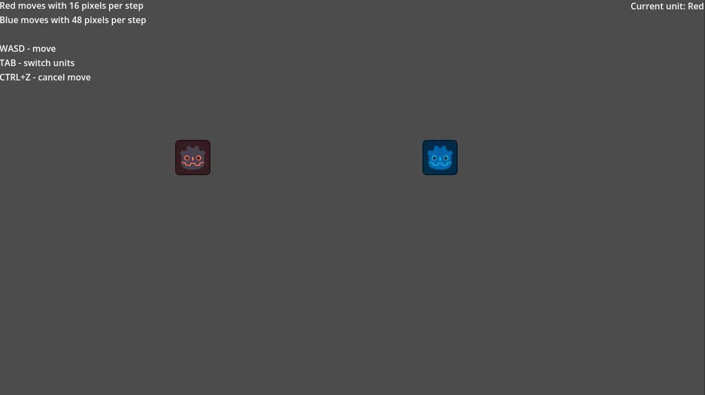
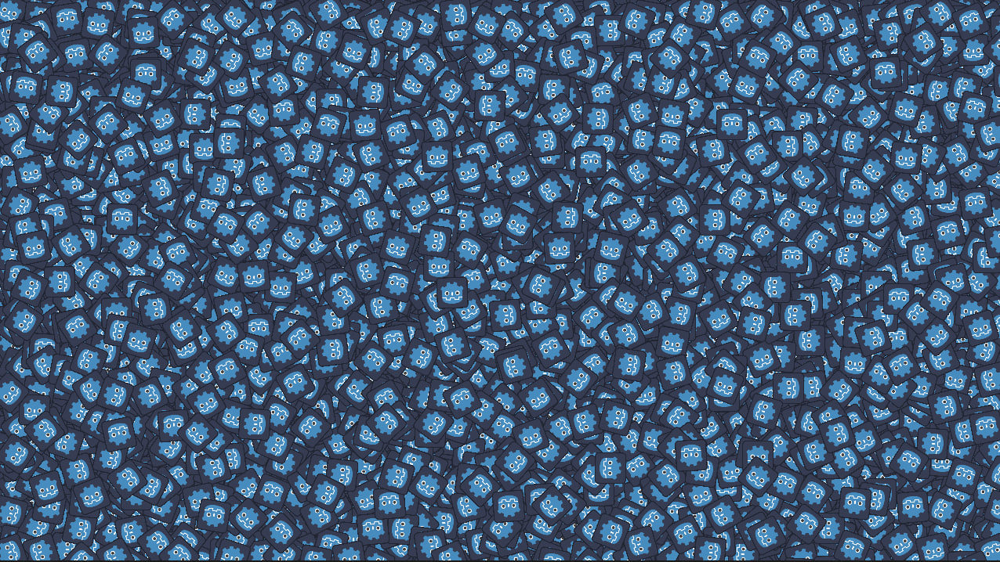
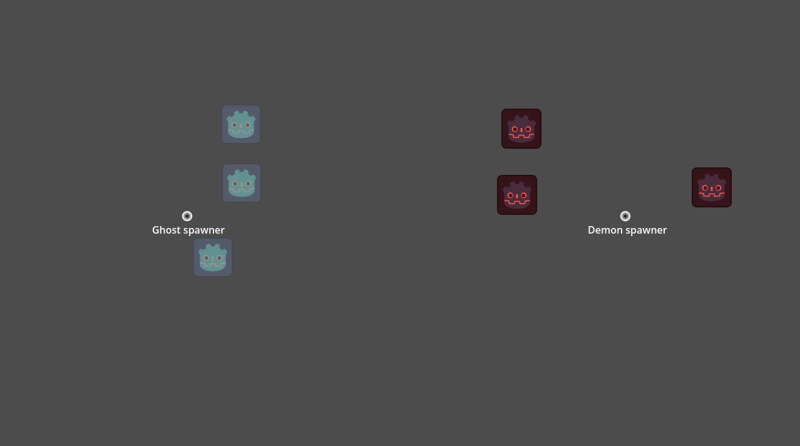
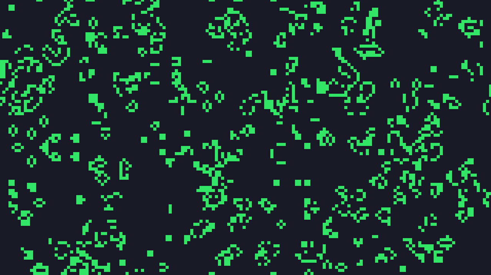
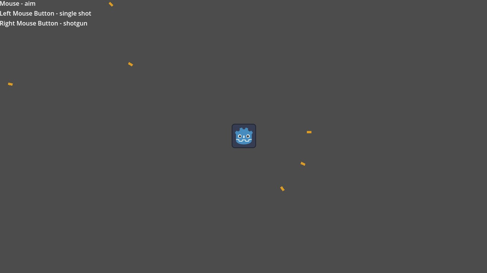
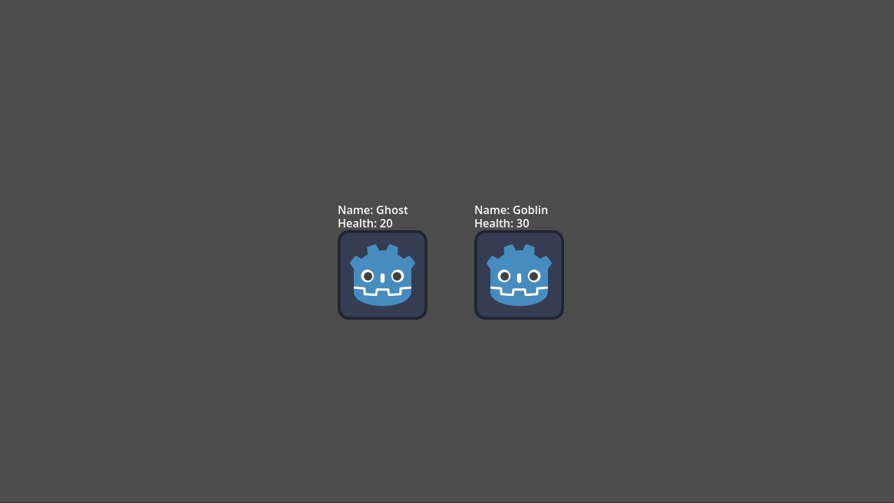
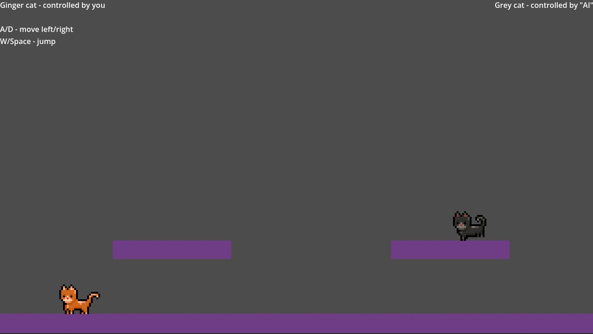
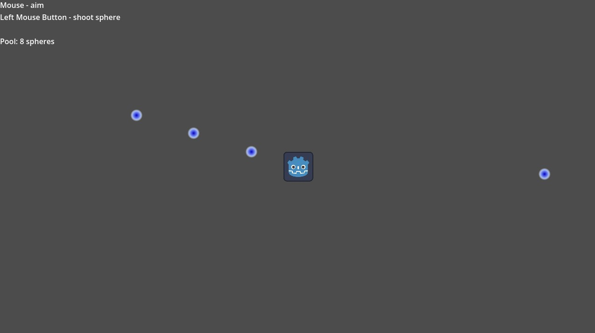

#  Паттерны программирования в Godot
Russian | [English](./README.md)

Адаптация паттернов в Godot из книги [Шаблоны игрового программирования Роберта Найстрома](https://jabocrack1.gitbook.io/shabloni-igrovogo-programmirovaniya).

Подготовлено на **Godot v4.7.2**.

## Как пользоваться
* Скачайте этот репозиторий и откройте его через Godot.
* Откройте любую директорию паттерна и запустите сцену (например, `01_command/command_example.tscn`).

## Паттерны
### [Команда (Command)](./01_command) [[Книга](https://jabocrack1.gitbook.io/shabloni-igrovogo-programmirovaniya/obzor-shablonov-proektirovaniya/komanda-command)]
Сцена: `01_command/command_example.tscn`

Реализован в виде передвижения двух юнитов, с возможностью переключения и отмены ходов.

### [Приспособленец (Легковес, Flyweight)](./02_flyweight) [[Книга](https://jabocrack1.gitbook.io/shabloni-igrovogo-programmirovaniya/obzor-shablonov-proektirovaniya/prisposoblenets-flyweight)]
Сцена: `02_flyweight/multi_mash_example.tscn`

Реализован с использованием нативного [MultiMesh](https://docs.godotengine.org/ru/4.x/classes/class_multimeshinstance2d.html).
Рендерит 100к объектов с простыми анимациями. Рекомендуется проверить производительность из меню отладки.

Сцена: `02_flyweight/bad_example.tscn`

Плохой, неоптимизированный пример для сравнения.
Рендерит 100к [Sprite2D](https://docs.godotengine.org/ru/4.x/classes/class_sprite2d.html#) с простыми анимациями. Рекомендуется проверить производительность из меню отладки.

### Наблюдатель (Observer) [[Книга](https://jabocrack1.gitbook.io/shabloni-igrovogo-programmirovaniya/obzor-shablonov-proektirovaniya/nablyudatel-observer)]
Пример отсутствует. Нативно реализован в виде [сигналов](https://docs.godotengine.org/ru/4.x/getting_started/introduction/key_concepts_overview.html#signals).

### [Прототип (Prototype)](./03_prototype) [[Книга](https://jabocrack1.gitbook.io/shabloni-igrovogo-programmirovaniya/obzor-shablonov-proektirovaniya/prototip-prototype)]
Сцена: `03_prototype/prototype_example.tscn`

Реализован с помощью [`Node.duplicate()`](https://docs.godotengine.org/ru/4.x/classes/class_node.html#class-node-method-duplicate). Спавнит 2 типа монстров через промежуток времени.

### Синглтон (Singleton) [[Книга](https://jabocrack1.gitbook.io/shabloni-igrovogo-programmirovaniya/obzor-shablonov-proektirovaniya/singlton-singleton)]
Пример отсутствует. Может быть легко реализован с помощью [автозагрузки (autoload)](https://docs.godotengine.org/ru/4.x/tutorials/scripting/singletons_autoload.html).
Лучше обратить внимание на причины, почему автор не рекомендует его использовать.

### [Состояние (State)](./04_state) [[Книга](https://jabocrack1.gitbook.io/shabloni-igrovogo-programmirovaniya/obzor-shablonov-proektirovaniya/sostoyanie-state#ierarkhicheskaya-mashina-sostoyanii-ili-ierarkhicheskii-avtomat)]
Сцена: `04_state/fsm_example.tscn`

Простая реализация двигающегося [CharacterBody2D](https://docs.godotengine.org/ru/4.x/classes/class_characterbody2d.html) с использованием конечных автоматов (Finite State Machine).

Также, обратите внимание на другие реализации FSM: [gdquest](https://www.gdquest.com/tutorial/godot/design-patterns/finite-state-machine/), [gd-YAFSM](https://github.com/imjp94/gd-YAFSM), [Machina](https://github.com/sempitern0/machina)... Их очень много.

Сцена: `04_state/csm_example.tscn`

Простая реализация двигающегося [CharacterBody2D](https://docs.godotengine.org/ru/4.x/classes/class_characterbody2d.html) с атаками оружия используя несколько FSM (Конкурентный автомат, Concurrent State Machines).

*Я слишком ленивый для реализации Иерархичной (Hierarchical) или С магазинной памятью (Pushdown Automata). Это не сильно сложнее когда понимаешь принцип простых FSM.*

### [Двойная буферизация (Double Buffering)](./05_double_buffering) [[Книга](https://jabocrack1.gitbook.io/shabloni-igrovogo-programmirovaniya/posledovatelnie-shabloni-sequencing-patterns/dvoinaya-buferizatsiya-double-buffering)]
Сцена: `05_double_buffering/double_buffering_example.tscn`

Реализован в виде [Игры "Жизнь"](https://ru.wikipedia.org/wiki/%D0%98%D0%B3%D1%80%D0%B0_%C2%AB%D0%96%D0%B8%D0%B7%D0%BD%D1%8C%C2%BB) с использованием [`CanvasItem._draw()`](https://docs.godotengine.org/ru/4.x/classes/class_canvasitem.html#class-canvasitem-private-method-draw).

### Игровой цикл (Game Loop) [[Книга](https://jabocrack1.gitbook.io/shabloni-igrovogo-programmirovaniya/posledovatelnie-shabloni-sequencing-patterns/igrovoi-tsikl-game-loop)]
Смотрите [SceneTree](https://docs.godotengine.org/ru/4.x/classes/class_scenetree.html).

### Метод обновления (Update method) [[Книга](https://jabocrack1.gitbook.io/shabloni-igrovogo-programmirovaniya/posledovatelnie-shabloni-sequencing-patterns/metodi-obnovleniya-update-methods)]
Смотрите [Уведомления Godot](https://docs.godotengine.org/ru/4.x/tutorials/best_practices/godot_notifications.html), особенно `_process`/`_physics_process`.

### Байткод (Bytecode) [[Книга](https://jabocrack1.gitbook.io/shabloni-igrovogo-programmirovaniya/povedencheskie-shabloni-behavioral-patterns/baitkod-bytecode#mashinnyi-kod-virtualnyi)]
Это довольно сложная для реализации часть. В Godot уже есть [GDScriptVM](https://deepwiki.com/godotengine/godot/6.3-gdscript-compiler-and-vm) - можно воспользоваться этим преимуществом и не создавать собственный язык программирования.
Главное — внимательно следить за тем, к каким API открыт доступ.
Рекомендуется использовать [Ресурсы](https://docs.godotengine.org/ru/4.x/classes/class_resource.html#), чтобы можно было корректировать баланс игры без изменения исходного кода.
Если же логика оказывается слишком сложной или динамичной (как карты в Slay the Spire 2), на помощь могут прийти другие паттерны проектирования типа **Команды (Command)**.

Что касается поддержки модов, стоит изучить [руководство по моддингу](https://brotato.wiki.spellsandguns.com/Modding) для игры Brotato, в нем также используется [Godot Mod Loader](https://wiki.godotmodding.com/).

### [Подкласс песочница (Subclass Sandbox)](./06_subclass_sandbox) [[Книга](https://jabocrack1.gitbook.io/shabloni-igrovogo-programmirovaniya/povedencheskie-shabloni-behavioral-patterns/podklass-pesochnitsa-subclass-sandbox)]
Сцена: `06_subclass_sandbox/subclass_sandbox_example.tscn`

Паттерн реализован в виде стрельбы с двумя режимами.

### [Объект тип (Type Object)](./07_type_object) [[Книга](https://jabocrack1.gitbook.io/shabloni-igrovogo-programmirovaniya/povedencheskie-shabloni-behavioral-patterns/obekt-tip-type-object)]
Сцена: `07_type_object/type_object_example.tscn`

Реализовано используя Resource.

## [Компонент (Component)](./08_component) [[Книга](https://jabocrack1.gitbook.io/shabloni-igrovogo-programmirovaniya/shabloni-snizheniya-svyaznosti-decoupling-patterns/komponent-component#zadacha)]
Сцена: `08_component/component_example.tscn`

Два кота. Один управляется вами, другой - автоматически.

*[Asset](https://bowpixel.itch.io/meow-cat-85-animation) by bowpixel*

## Очередь событий (Event Queue) [[Книга](https://jabocrack1.gitbook.io/shabloni-igrovogo-programmirovaniya/shabloni-snizheniya-svyaznosti-decoupling-patterns/ochered-sobitii-event-queue)]
Без примера. Используйте [`call_deferred()`](https://docs.godotengine.org/ru/4.x/classes/class_callable.html#class-callable-method-call-deferred) для методов или [`CONNECT_DEFERRED`](https://docs.godotengine.org/ru/4.x/classes/class_object.html#id5) для сигналов.
If it's not enough, can be easily implemented using array + `pop_front()`.

Также одна из реализаций [Шины событий (Event Bus)](https://dev.to/bajathefrog/riding-the-event-bus-in-godot-ped).

## [Поиск службы (Service Locator)](./09_service_locator) [[Книга](https://jabocrack1.gitbook.io/shabloni-igrovogo-programmirovaniya/shabloni-snizheniya-svyaznosti-decoupling-patterns/poisk-sluzhbi-service-locator)]
Сцена: `09_service_locator/service_locator_example.tscn`

Реализован как синглтон в автозагрузке.

## Локальность данных (Data Locality) [[Книга](https://jabocrack1.gitbook.io/shabloni-igrovogo-programmirovaniya/shabloni-optimizatsii/lokalnost-dannih-data-locality)]
Не требует реализации. Смотрите [Оптимизация CPU](https://docs.godotengine.org/ru/4.x/tutorials/performance/cpu_optimization.html).

## Грязный флаг (Dirty Flag) [[Книга](https://jabocrack1.gitbook.io/shabloni-igrovogo-programmirovaniya/shabloni-optimizatsii/gryaznii-flag-dirty-flag)]
Не требует реализации.

## [Пул объектов (Object Pool)](./10_object_pool) [[Книга](https://jabocrack1.gitbook.io/shabloni-igrovogo-programmirovaniya/shabloni-optimizatsii/pul-obektov-object-pool)]
Сцена: `10_object_pool/object_pool_example.tscn`

Маг стреляет сферами из своего пула.

